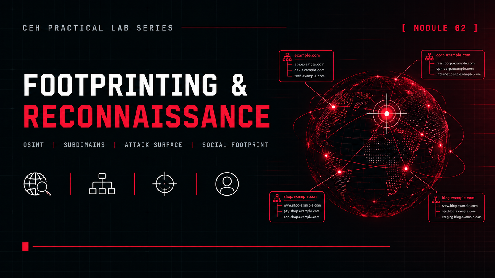

  

<h1>Module 02 — Footprinting and Reconnaissance</h1>
<h3>Cloud Reconnaissance in Four Phases Against a Public Domain</h3>

 

  

<a href="#phases"><b>Phases</b></a> &nbsp;·&nbsp;
<a href="#findings-summary"><b>Findings</b></a> &nbsp;·&nbsp;
<a href="#recommendations"><b>Recommendations</b></a> &nbsp;·&nbsp;
<a href="#key-takeaways"><b>Takeaways</b></a> &nbsp;·&nbsp;
<a href="#lab-environment"><b>Environment</b></a>

 

---

## Executive Summary

This module documents a four-phase reconnaissance exercise against `microsoft.com`, moving from passive domain intelligence to infrastructure discovery, attack surface analysis and social footprinting. The work ran from **April 16 to April 28, 2026** as the **IDS-CRACK Cloud Reconnaissance Framework**.

Only public assets and public data sources were used: DNS resolution, HTTP probing and username lookups.

> Findings are summarised without hostnames or raw tool output. Only the count of affected subdomains is recorded.

 

## Phases

<table>
<tr><th>Phase</th><th>Date</th><th>Focus</th><th>Tools</th></tr>
<tr><td><b>1</b></td><td>Apr 16 to 17</td><td>Domain intelligence (passive OSINT)</td><td><code>Google Dorking</code> <code>Netcraft</code> <code>DNSDumpster</code> <code>theHarvester</code> <code>Whois</code> <code>Reverse Whois</code> <code>Archive.org</code></td></tr>
<tr><td><b>2</b></td><td>Apr 17</td><td>Infrastructure discovery</td><td><code>Subfinder</code> <code>DNSrecon</code> <code>nslookup</code> <code>httpx</code> <code>Shodan</code> <code>Censys</code> <code>Traceroute</code></td></tr>
<tr><td><b>3</b></td><td>Apr 18</td><td>Subdomain takeover detection, DNS resolution</td><td><code>Subzy</code> <code>DNSX</code> <code>httpx</code> <code>Amass</code> <code>Recon-ng</code></td></tr>
<tr><td><b>4</b></td><td>Apr 23 to 28</td><td>Social footprint and AI-assisted OSINT</td><td><code>Sherlock v0.15.0</code> <code>SGPT (Shell GPT)</code> <code>theHarvester 4.10.1</code></td></tr>
</table>

 

## Findings Summary

<table>
<tr><th>Phase</th><th>Key Results</th></tr>
<tr><td><b>1</b></td><td>76,856+ domains registered to the organisation, defensive registrations confirmed, 289+ subdomains from theHarvester, admin portals publicly indexed, public XLS and CSV sample files, strict SPF (<code>-all</code>), old Silverlight and ASPX endpoints visible in Archive.org</td></tr>
<tr><td><b>2</b></td><td>49,273 subdomains from Subfinder, 652 confirmed live HTTP/HTTPS hosts, zone transfers blocked on all nameservers, strict DMARC (<code>p=reject</code>), Azure and Akamai multi-layer architecture</td></tr>
<tr><td><b>3</b></td><td>6 subdomains confirmed vulnerable to takeover (dangling CNAMEs), CNAME chains of up to 4 hops, mixed HTTP and HTTPS hosts, 50 unique host endpoints enumerated</td></tr>
<tr><td><b>4</b></td><td>Username <code>microsoft</code> found on 214+ platforms, strong presence on GitHub, npm, Docker Hub and Hugging Face, AI-driven theHarvester found 7 live hosts from the Baidu index</td></tr>
</table>

 

## Recommendations

Recommendations from the Phase 3 report.

<table>
<tr><th>Priority</th><th>Action</th></tr>
<tr><td><b>1</b></td><td>Remediate the confirmed subdomain takeover issues</td></tr>
<tr><td><b>2</b></td><td>Audit every CNAME record across all subdomains</td></tr>
<tr><td><b>3</b></td><td>Enforce HTTPS-only</td></tr>
<tr><td><b>4</b></td><td>Monitor subdomains continuously</td></tr>
<tr><td><b>5</b></td><td>Review Azure Front Door and Traffic Manager configurations</td></tr>
</table>

 

## Key Takeaways

- **Public data goes a long way.** Passive sources alone revealed domains, subdomains, indexed admin portals and historic endpoints.
- **Strong email and DNS controls were visible.** Strict SPF and DMARC policies were in place and zone transfers were blocked on all nameservers.
- **Subdomain takeover is a real risk.** A dangling CNAME lets an attacker claim the target and serve content under a trusted subdomain.
- **Social footprints extend the attack surface.** The same username appeared on 214+ platforms.

 

## Lab Environment

| | |
|---|---|
| **Target** | `microsoft.com` (public assets only) |
| **Period** | April 16 to April 28, 2026 |
| **Approach** | Passive and low-intensity: public data sources, DNS resolution, HTTP probing, username lookups |
| **Output** | Summarised findings, no hostnames or raw tool output |

 

## Disclaimer

This exercise used publicly available data sources for educational purposes under the EC-Council CEH curriculum. Hostnames and raw tool output are intentionally not published.

 

⬅ <a href="../"><b>Back to Main Repository</b></a>

