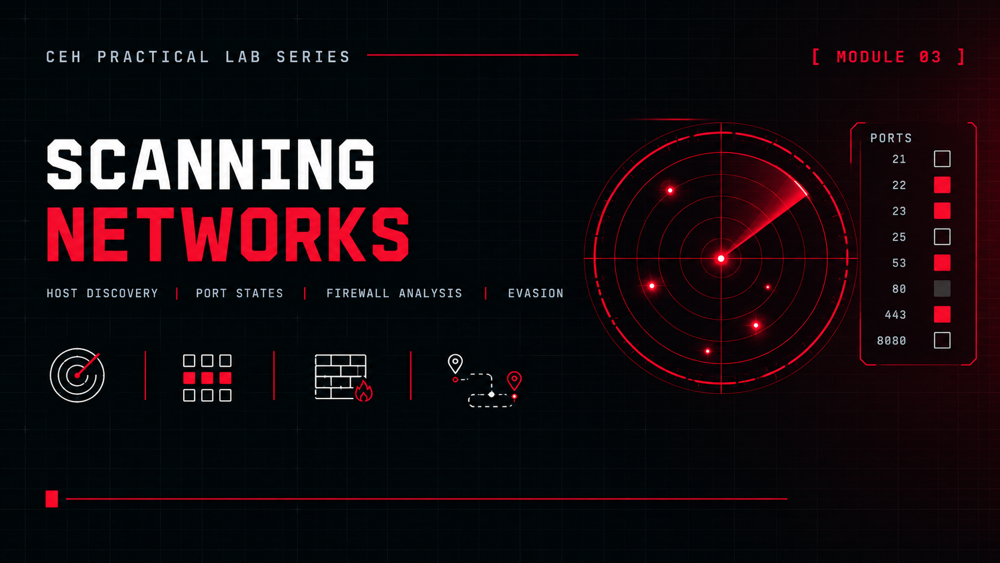

  

# Module 03: Scanning Networks

### Advanced host discovery and port analysis in an isolated lab

[Back to portfolio](../README.md) · [Report (PDF)](./Scanning.pdf)

---

## Overview

A hands-on progression through the scanning phase of a security assessment, from foundational techniques to evasion and automation. All scans ran inside an isolated lab with no internet access.

|                  |                                                              |
| ---------------- | ------------------------------------------------------------ |
| **Network**      | VirtualBox host-only network `192.168.100.0/24`              |
| **Targets**      | Metasploitable 2 · Ubuntu with DVWA · Windows 10             |
| **Tools**        | `hping3` `Nmap` `Zenmap` `Metasploit`                        |

## Coverage

| Area                     | Techniques                                                                 |
| ------------------------ | -------------------------------------------------------------------------- |
| Host discovery           | Custom packet crafting with hping3                                         |
| Scan types               | TCP SYN, SYN-ACK, FIN, RST, NULL and Idle (Zombie) scanning                |
| Firewall behaviour       | Detecting ICMP and TCP filtering                                           |
| Port state classification | SYN, Connect and ACK scans                                                |
| Evasion                  | Fragmentation, source port manipulation, decoy scanning                    |
| Automation               | Adaptive multi-target scanners                                             |
| GUI analysis             | Zenmap                                                                     |
| Framework scanning       | Metasploit auxiliary modules, compared against standalone Nmap results     |

## Outcome

Hosts were discovered reliably, port states were classified, firewall filtering behaviour was identified, and evasion techniques were applied. Results from standalone Nmap and Metasploit workflows were checked for consistency.
