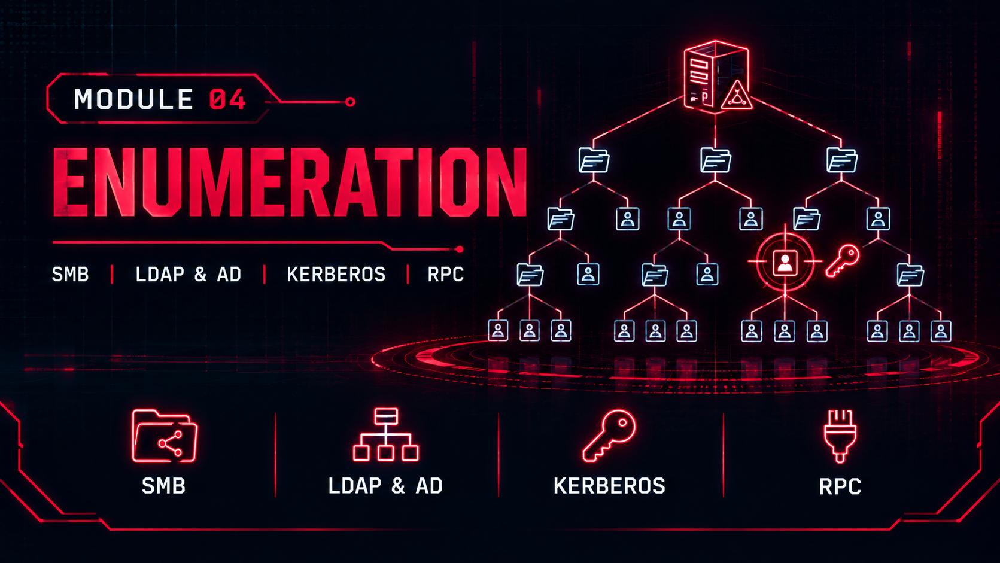

  

# Module 04: Enumeration

### Advanced reconnaissance and attack surface mapping

[Back to portfolio](../README.md) · [Report (PDF)](./Enumeration.pdf)

---

## Overview

A deep enumeration phase covering six techniques against intentionally vulnerable systems and modern hardened Windows systems. The contrast between the two shows how much legacy configuration exposes and what a hardened system still leaves visible.

|                  |                                                                                 |
| ---------------- | ------------------------------------------------------------------------------- |
| **Network**      | VirtualBox host-only network `192.168.100.0/24`                                 |
| **Targets**      | Metasploitable 2 · DVWA · Windows 10 · Windows Server 2025 (domain controller)  |
| **Tools**        | `enum4linux` `CrackMapExec` `AD Explorer` `kerbrute` `Gobuster` `ffuf` `Nikto`  |

## Techniques

| Technique                  | What was done                                                                          |
| -------------------------- | -------------------------------------------------------------------------------------- |
| SMB/CIFS enumeration       | Null sessions, share, user and group extraction with enum4linux and CrackMapExec       |
| LDAP / Active Directory    | Anonymous binds, AD Explorer, domain structure mapping                                 |
| Kerberos user enumeration  | kerbrute against port 88                                                               |
| RPC / DCOM enumeration     | Endpoint mapping, 351 to 527 endpoints including SAM and DRSUAPI                       |
| Web service enumeration    | Fingerprinting, directory brute-forcing with Gobuster and ffuf, Nikto, API discovery   |
| Database enumeration       | Unauthenticated MySQL access and offline hash cracking                                 |

## Key Contrast

| System                         | Result                                                                                                    |
| ------------------------------ | --------------------------------------------------------------------------------------------------------- |
| Metasploitable 2               | Null SMB sessions, unauthenticated MySQL root access, exposed admin panels                                |
| Windows 10 and Server 2025     | Null sessions correctly blocked, but RPC, LDAP and Kerberos still expose surfaces that support follow-up attacks such as Kerberoasting and AS-REP Roasting |
