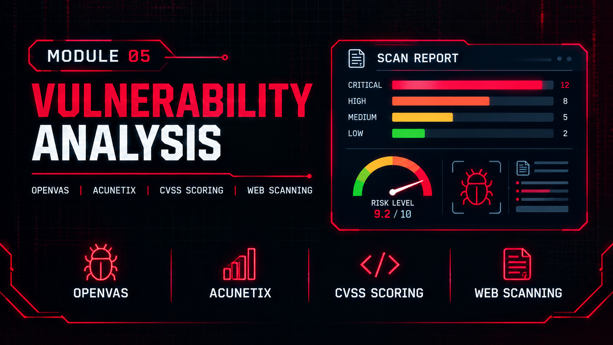

  

<h1>Module 05 — Vulnerability Analysis</h1>
<h3>Network and Web Application Vulnerability Assessment of Metasploitable 2</h3>

 

  

<a href="#lab-topology"><b>Topology</b></a> &nbsp;·&nbsp;
<a href="#lab-1--nmap-and-openvas"><b>Lab 1</b></a> &nbsp;·&nbsp;
<a href="#lab-2--acunetix"><b>Lab 2</b></a> &nbsp;·&nbsp;
<a href="#key-takeaways"><b>Takeaways</b></a> &nbsp;·&nbsp;
<a href="#full-reports"><b>Full Reports</b></a>

 

---

## Executive Summary

This module documents two assessments against the same target: a network-level scan with **Nmap and OpenVAS**, and a web application scan with **Acunetix**. Together they show how network-level and application-level scanning differ, and how findings are prioritised by CVSS score and Threat Level.

> All testing was performed in a private, isolated virtual network. All IP addresses shown are lab-only values.

 

## Lab Topology

<table>
<tr><th>Item</th><th>Detail</th></tr>
<tr><td><b>Target</b></td><td>Metasploitable 2 (<code>192.168.100.148</code>)</td></tr>
<tr><td><b>Scanner</b></td><td>Kali Linux (<code>192.168.100.140</code>), isolated lab</td></tr>
<tr><td><b>Tools</b></td><td><code>Nmap</code> <code>OpenVAS</code> <code>Acunetix</code></td></tr>
</table>

 

## Lab 1 — Nmap and OpenVAS

Nmap found 30 open TCP ports with service versions. OpenVAS ran unauthenticated and credentialed scans and reported 64 findings with a quality of detection of 70% or higher. The highest CVSS score was 10.0. The credentialed scan added no extra findings.

<table>
<tr><th>Severity</th><th>Findings</th></tr>
<tr><td><b>Critical</b></td><td>10</td></tr>
<tr><td><b>High</b></td><td>11</td></tr>
<tr><td><b>Medium</b></td><td>37</td></tr>
<tr><td><b>Low</b></td><td>6</td></tr>
</table>

<table>
<tr><th>Issue Type</th><th>Examples</th></tr>
<tr><td><b>Backdoored Services</b></td><td>vsftpd 2.3.4, UnrealIRCd, Ingreslock (root shell on port 1524)</td></tr>
<tr><td><b>Unauthenticated RCE</b></td><td>DistCC, Samba, Java RMI, Tomcat Ghostcat, PHP-CGI</td></tr>
<tr><td><b>Weak Authentication</b></td><td>Default credentials (PostgreSQL, VNC, FTP), passwordless rlogin and rsh</td></tr>
<tr><td><b>End-of-Life Operating System</b></td><td>Ubuntu 8.04, unsupported since 2013, the root cause</td></tr>
</table>

**Remediation:** disable the backdoored services and rebuild the system on a supported operating system.

 

## Lab 2 — Acunetix

An automated web scan of DVWA and Mutillidae returned **Threat Level 3 (High)**.

<table>
<tr><th>Finding</th><th>Detail</th></tr>
<tr><td><b>PHP-CGI Remote Code Execution</b></td><td>CVE-2012-1823 and CVE-2012-2311</td></tr>
<tr><td><b>Directory Traversal and File Inclusion</b></td><td>Mutillidae <code>page</code> parameter</td></tr>
<tr><td><b>Cross-Site Scripting</b></td><td>Confirmed on the tested applications</td></tr>
<tr><td><b>Configuration Source Disclosure</b></td><td><code>config.inc.php~</code> backup file</td></tr>
<tr><td><b>Database Credential Exposure</b></td><td>MySQL/MariaDB credentials visible through <code>phpinfo.php</code></td></tr>
</table>

**Remediation:** validate input, remove backup and configuration files from the web root, and disable CGI-based PHP execution.

 

## Key Takeaways

- **An unsupported OS is the root cause.** Ubuntu 8.04 has been end-of-life since 2013, and most findings trace back to it.
- **Network and web scanners see different things.** OpenVAS found backdoors and service flaws, while Acunetix found application flaws such as XSS and file inclusion.
- **Credentialed scanning is not always more.** Here the credentialed scan added no extra findings over the unauthenticated one.
- **Prioritise by score.** CVSS (up to 10.0) and Acunetix Threat Level put the critical issues first.

 

## CEH Mapping

<table>
<tr><th>Lab</th><th>Topic</th></tr>
<tr><td><b>Nmap and OpenVAS</b></td><td>Network vulnerability assessment, authenticated and unauthenticated scanning, CVSS scoring</td></tr>
<tr><td><b>Acunetix</b></td><td>Web application scanning, OWASP-style flaws, Threat Level rating</td></tr>
</table>

 

## Full Reports

📄 **[OpenVAS.pdf](./OpenVAS.pdf)**
📄 **[Acunetix.pdf](./Acunetix.pdf)**

 

## Disclaimer

This lab was conducted in a private, isolated virtual environment built solely for educational purposes under the EC-Council CEH curriculum. No real production systems or live targets were scanned.

 

⬅ <a href="../"><b>Back to Main Repository</b></a>

