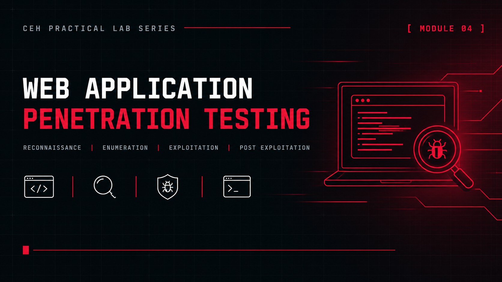

<p align="center">
  
</p>

<h1 align="center">Certified Ethical Hacker Lab Portfolio</h1>

<h3 align="center">Hands-on CEH modules: reconnaissance, scanning, enumeration and vulnerability analysis</h3>

<p align="center">
  
  
  
  
</p>

<p align="center">
  <a href="#overview"><b>Overview</b></a> ·
  <a href="#modules"><b>Modules</b></a> ·
  <a href="#key-results"><b>Key Results</b></a> ·
  <a href="#roadmap"><b>Roadmap</b></a> ·
  <a href="#lab-environment"><b>Environment</b></a> ·
  <a href="#repository-structure"><b>Structure</b></a> ·
  <a href="#contact"><b>Contact</b></a>
</p>

---

## Overview

This repository documents my practical work for the EC-Council Certified Ethical Hacker (CEH) curriculum. Each completed module has its own folder with a README that covers the scenario, the tools used and the key findings. Modules are added as I finish them.

|                       |                                                                                  |
| --------------------- | -------------------------------------------------------------------------------- |
| **Certification**     | EC-Council Certified Ethical Hacker (CEH)                                        |
| **Completed**         | Modules 02 to 05 (practical work)                                                |
| **Module 02 scope**   | Public data sources and light probing of one organisation's public assets        |
| **Modules 03 to 05**  | Isolated VirtualBox host-only network                                            |
| **Format**            | One folder per module, each with its own `README.md`                             |

## Modules

| #  | Module                                                                                    | Focus                                                                     | Core Tools                                                                  |
| -- | ----------------------------------------------------------------------------------------- | ------------------------------------------------------------------------- | --------------------------------------------------------------------------- |
| 02 | [Footprinting and Reconnaissance](./02-Footprinting-and-Reconnaissance/README.md)         | Four-phase reconnaissance: domains, infrastructure, attack surface, social footprint | `theHarvester` `Subfinder` `httpx` `Shodan` `Censys` `Subzy` `Amass` `Sherlock` |
| 03 | [Scanning Networks](./03-Scanning-Networks/README.md)                                     | Host discovery, port states, firewall behaviour, evasion, automation      | `hping3` `Nmap` `Zenmap` `Metasploit`                                       |
| 04 | [Enumeration](./04-Enumeration/README.md)                                                 | SMB, LDAP and Active Directory, Kerberos, RPC, web and database services  | `enum4linux` `CrackMapExec` `kerbrute` `Gobuster` `ffuf` `Nikto`            |
| 05 | [Vulnerability Analysis](./05-Vulnerability-Analysis/README.md)                           | Network and web application vulnerability assessment                      | `Nmap` `OpenVAS` `Acunetix`                                                 |

## Key Results

| Module                     | Result                                                                                                                       |
| -------------------------- | ---------------------------------------------------------------------------------------------------------------------------- |
| 02 Footprinting            | 49,273 subdomains found with Subfinder, 652 confirmed live web hosts, zone transfers blocked on all nameservers              |
| 03 Scanning                | Host discovery, port classification, firewall analysis and evasion, with Nmap and Metasploit results compared                |
| 04 Enumeration             | Metasploitable 2 exposed null SMB sessions and unauthenticated MySQL; Windows 10 and Server 2025 blocked null sessions       |
| 05 Vulnerability Analysis  | OpenVAS: 64 findings (10 critical, 11 high, 37 medium, 6 low). Acunetix: Threat Level 3 (High)                               |

## Roadmap

The remaining CEH modules will be added here once the labs are complete.

| #  | Module                                  | Status  |
| -- | --------------------------------------- | ------- |
| 01 | Introduction to Ethical Hacking         | Planned |
| 06 | System Hacking                          | Planned |
| 07 | Malware Threats                         | Planned |
| 08 | Sniffing                                | Planned |
| 09 | Social Engineering                      | Planned |
| 10 | Denial-of-Service                       | Planned |
| 11 | Session Hijacking                       | Planned |
| 12 | Evading IDS, Firewalls and Honeypots    | Planned |
| 13 | Hacking Web Servers                     | Planned |
| 14 | Hacking Web Applications                | Planned |
| 15 | SQL Injection                           | Planned |
| 16 | Hacking Wireless Networks               | Planned |
| 17 | Hacking Mobile Platforms                | Planned |
| 18 | IoT and OT Hacking                      | Planned |
| 19 | Cloud Computing                         | Planned |
| 20 | Cryptography                            | Planned |

## Lab Environment

|                       |                                                                                          |
| --------------------- | ---------------------------------------------------------------------------------------- |
| **Hypervisor**        | VirtualBox                                                                               |
| **Network**           | Isolated host-only network `192.168.100.0/24`                                            |
| **Attacker machine**  | Kali Linux                                                                               |
| **Targets**           | Metasploitable 2 · Ubuntu with DVWA · Windows 10 · Windows Server 2025 (domain controller) |
| **Scope**             | Every attack in Modules 03 to 05 targets only machines inside the lab topology           |

## Repository Structure

```
certified-ethical-hacker-lab-portfolio/
├── README.md
├── LICENSE
├── images/
│   └── banner.png
│
├── 02-Footprinting-and-Reconnaissance/
│   ├── README.md
│   └── images/
│       └── cover.png
├── 03-Scanning-Networks/
│   ├── README.md
│   ├── Scanning.pdf
│   └── images/
│       └── cover.png
├── 04-Enumeration/
│   ├── README.md
│   ├── Enumeration.pdf
│   └── images/
│       └── cover.png
└── 05-Vulnerability-Analysis/
    ├── README.md
    ├── OpenVAS.pdf
    ├── Acunetix.pdf
    └── images/
        └── cover.png
```

## License

**© 2026 Abdul Wahid**. Licensed under [**CC BY-NC-ND 4.0**](./LICENSE) (Attribution, NonCommercial, NoDerivatives). You may view, reference and share a link to this work with credit. Commercial use and redistributing modified copies are not permitted.

## Disclaimer

Modules 03 to 05 were carried out in a private, isolated virtual network built for study. Module 02 used publicly available data sources, and its findings are summarised without hostnames or raw tool output. Credentials and IP addresses shown in this repository are lab-only values.

## Contact

<p align="center">
  <b>Abdul Wahid</b><br/>
  Certified Ethical Hacker (CEH) Candidate — EC-Council
</p>

<p align="center">
  <a href="mailto:a.wahid7860668@gmail.com"></a>
  <a href="https://www.linkedin.com/in/abdul-wahid022"></a>
  <a href="https://github.com/abdul-wahid022"></a>
</p>
